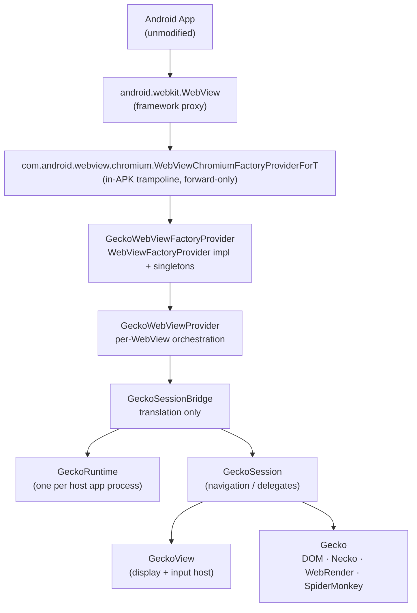
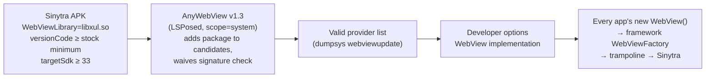
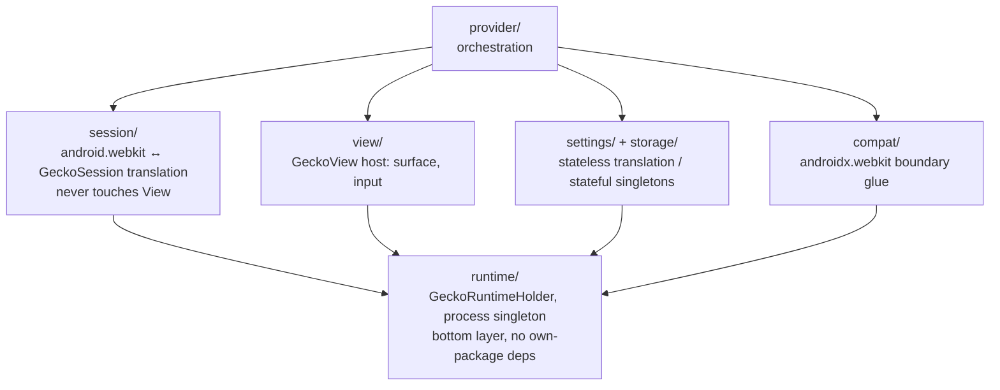

# Sinytra — a Gecko-powered Android System WebView

*中文版说明见 [README.zh-CN.md](README.zh-CN.md)。*

Sinytra is a third-party Android System WebView implementation: apps keep
calling `android.webkit.WebView` with **zero changes**, while the engine
underneath is Firefox/Gecko instead of Chromium.



> Personal, experimental project. Not affiliated with Mozilla or Google.
> Status, verdicts and triage logs live in [`docs/STATUS.md`](docs/STATUS.md)
> and [`docs/VERDICTS.md`](docs/VERDICTS.md); start there.

## Source-of-truth pins

| Item | Value |
|---|---|
| `TARGET_ANDROID_API` | 34 (Android 14, matches the test device) |
| `AOSP_BASE` | `android14-release` — interface semantics, class names and load flow reference only; never built, runtime truth is the on-device framework |
| `GECKOVIEW_VERSION` | `geckoview-nightly:158.0.20260924093433` |
| `FIREFOX_COMMIT` | `34ed69f161676c3ac7ca5f201fade6d081e5bcd2` (mozilla-central 158.0a1 tip; re-evaluate when the 158.0 release tag lands) |

Android 14's `WebViewFactory` hard-codes the Chromium factory class name
and reads no provider-declared factory metadata — so the trampoline class
above is the **only entry point** without modifying the framework (which
this project never does).

## Deployment (the only supported route)

Rooted phone + LSPosed + AnyWebView v1.3, switched via
*Developer options → WebView implementation*
(equivalent: `cmd webviewupdate set-webview-implementation`). No ROM
flashing, no framework modification, no overlays, no system signature.



Validity constraints (all verified on-device): manifest carries
`com.android.webview.WebViewLibrary = libxul.so` (the **real** library —
the framework's RELRO preload of it fails harmlessly, Gecko loads it
itself via `GeckoLoader`); `versionCode ≥ Minimum WebView version code`;
own package name (`moe.bemly.geckowebview`, debug: `.debug` suffix —
never squats `com.android.webview`).

## Architecture

### Package layering (one-way dependencies)



Rules that are enforced, not suggested:

- `GeckoRuntime`: **at most one live instance per host app process**
  (provider code is loaded *into* each WebView-using process — it is not
  system-wide, not shared across processes).
- `GeckoView` is **not** a layer below `GeckoRuntime`: it is a single
  session's display/input host
  (`session.open(runtime)` + `view.setSession(session)`). Headless
  sessions are managed manually via `setActive/setPriorityHint`.
- **History is owned by Gecko** (`SessionState` *is* the `HistoryList`).
  `StateBridge` only translates
  `SessionState/HistoryList ↔ WebBackForwardList/Bundle` — no second
  history stack. `HistoryDelegate` only records visits + change
  notifications.
- **Reuse-first**: anything GeckoView / `androidx.webkit` / framework
  already does is reused, never re-wrapped. New code is allowed only for:
  data GeckoView doesn't persist (visited store, form/password DBs, icon
  cache), Chromium semantics with no Gecko counterpart (JS-interface
  reflection, `WebMessagePort` channels, `Bundle` translation),
  no-framework-change adapters (trampoline, same-package subclasses),
  and the `sinytra-js` transport below.
- Glue is **Java 17 only**. C++/Gecko-JS only when a public GeckoView API
  genuinely lacks the primitive — each as an independent, independently
  tested patch under `firefox-patches/`.

### JavaScript transport: the built-in `sinytra-js` extension

`evaluateJavascript`, `addJavascriptInterface` and `WebMessage` need no
Gecko patch: a built-in WebExtension (`provider/src/main/assets/sinytra-js`,
id `sinytra-js@bemly.moe`) bridges page and Java. Content script polls a
per-session native mailbox (long-poll via `GeckoResult`); an injected
page-world shim executes evals, installs `window[iface]` stubs backed by
Java reflection, and routes port messages. Protocol and the 7-round
device investigation that ruled out Port-push are documented in
`content.js` / `JsBridge.java` header comments.

### Request interception: `firefox-patches/` 0001–0003

`shouldInterceptRequest` with response-body substitution rides a necko
`nsINetworkInterceptController` stack: filter distribution (0001),
method/headers fidelity + subframe stand-down (0002), and unbounded
streaming bodies over JNI via `GeckoViewInputStream` (0003 — the old
16 MB base64 cap solved a non-problem: the boundary is JNI, not IPC).

### Gecko patch stack (HEAD: 0024)

Each patch does exactly one thing, with its own test. Full log in
[`firefox-patches/README.md`](firefox-patches/README.md).

| # | What | WebView API it serves |
|---|---|---|
| 0001–0003 | Response-body interception line | `shouldInterceptRequest` bodies / request fidelity / streaming |
| 0004 | Synthesized-response SW tainting (ORB hardening) | top-level synthetic navigations |
| 0005 | `SINYTRA_LOG` macro + `sinytra.log.enabled` pref gate | debug instrumentation discipline |
| 0006 | Cert-override chain (failed-channel cert → stash → temporary override) | `SslErrorHandler.proceed()` |
| 0007/0011/0014/0016/0019 | Cookie-jar primitives + read/write scoping | `CookieManager` per-cookie semantics |
| 0008–0010 | greomni→provider APK, cross-package child services, network-state guard | running inside **third-party** host processes at all |
| 0012/0015 | Resource face + synthesis trace | policy decisions, triage |
| 0013 | `resource://android` → provider APK | JS transport under foreign hosts |
| 0017/0021–0023 | Binder bounded-failure + surface-handoff ordering | compositor teardown/startup recovery (GPU-ON root fix; M3/M3b documented fallbacks) |
| 0018 | UA-override push to the top context | `WebSettings` UA plumbing |
| 0020 | `file:///android_asset/` → host APK mapping | file-family CTS |
| 0024 | Image-policy docshell enforcement | `setLoadsImagesAutomatically` |

Reproducibility = `FIREFOX_COMMIT` + `firefox-patches/*.patch` applied in
order on a sibling checkout (never a submodule, never a partial fork).

## Repository layout (only diffs are stored)

```text
sinytra/
├── docs/                  # ARCHITECTURE / API_MAPPING / BOOTSTRAP / ROADMAP /
│                          #   STATUS / DEVICE / CTS / SOURCES / VERDICTS
├── provider/              # standalone Java 17 Gradle app (daily work lives here)
│   └── src/
│       ├── main/java/org/mozilla/geckowebview/
│       │   └── provider/ session/ view/ settings/ storage/ compat/ runtime/
│       ├── main/java/com/android/webview/chromium/  # entry trampoline
│       ├── main/java/android/webkit/                # same-package subclasses
│       ├── main/java/org/chromium/support_lib_glue/ # androidx boundary entry
│       ├── main/assets/sinytra-js/                  # built-in transport
│       └── debug/         # device harness + probes (LabActivity) — release has zero refs
├── framework-stubs/       # compileOnly android14 hidden-API stubs
├── firefox-patches/       # patch stack + per-patch design docs
└── tests/unit/            # JVM unit tests (one per bridge, minimum)
```

Stage gates (no skipping): P-1 bootstrap spike → P0 (~20% API renders) →
P1 (system capabilities) → P2 (hard problems + post-switch CTS).
Acceptance is always on the real switched path
(`new WebView()` through framework `WebViewFactory`); reflection
harnesses are regression tools only. Phases, scope and gates:
[`docs/ROADMAP.md`](docs/ROADMAP.md).

## Build & install

Prerequisites: JDK 17, Android SDK (platforms 34/36/37.x), a sibling
Firefox checkout on `sinytra-pin-158` with `objdir-158` built, Rust via
rustup. Everything below **must** carry `-PsinytraLocalGecko=true`
(master references patch-injected GeckoView types, so the stock AAR
build is red by design).

```bash
export JAVA_HOME=<jdk17> ANDROID_HOME=<sdk> \
  MOZCONFIG=<firefox>/mozconfig-158 \
  MOZBUILD_STATE_PATH=<mozbuild> PATH="$HOME/.cargo/bin:$PATH"

./gradlew :provider:testDebugUnitTest -PsinytraLocalGecko=true  # JVM locks
./gradlew :provider:lintDebug -PsinytraLocalGecko=true          # lint gate
./gradlew :provider:assembleDebug -PsinytraLocalGecko=true     # debug APK

adb -s <serial> install -r provider/build/outputs/apk/debug/provider-debug.apk
adb -s <serial> shell "su -c 'dumpsys webviewupdate'" | grep -A12 'WebView packages'
adb -s <serial> shell cmd webviewupdate set-webview-implementation moe.bemly.geckowebview.debug
```

A freshly added package name joins the candidate list at
`system_server` start — after first install, **reboot once**, then switch.
Roll back any time:
`cmd webviewupdate set-webview-implementation com.google.android.webview`.

Debug builds additionally ship **Sinytra Lab** (launcher icon): address
bar with scheme-aware navigation, User-Agent override with
`navigator.userAgent` readback, one-tap `about:about/config/support/
buildconfig`. Release builds contain none of it.

## Testing

- `tests/unit` — JUnit, mapping logic + edge values per bridge.
- `provider/src/debug` — on-device harness (reflection-injection
  regression) + real-path probes post-switch.
- CTS — `CtsWebkitTestCases` (android-cts-14_r7 arm) run directly via
  `am instrument` on the switched device; Chromium baseline 98.6% is the
  denominator, every failure triaged (Gecko semantic / unimplemented /
  upstream bug). Per-case ledger: [`docs/VERDICTS.md`](docs/VERDICTS.md).

## Docs index

| File | Covers |
|---|---|
| [`docs/ARCHITECTURE.md`](docs/ARCHITECTURE.md) | Choices, core classes, layering, history, runtime facts, language policy |
| [`docs/API_MAPPING.md`](docs/API_MAPPING.md) | GeckoView delegate/controller/settings lookup (check before any new bridge) |
| [`docs/BOOTSTRAP.md`](docs/BOOTSTRAP.md) | P-1 acceptance, AnyWebView route, dependency models, workspace |
| [`docs/ROADMAP.md`](docs/ROADMAP.md) | Stages, P2 hard-item list, acceptance |
| [`docs/STATUS.md`](docs/STATUS.md) | Progress, next steps, blockers — read first each session |
| [`docs/DEVICE.md`](docs/DEVICE.md) | Test-device file, adb flows, hygiene/reboot discipline |
| [`docs/CTS.md`](docs/CTS.md) | CTS procedure + Chromium baseline |
| [`docs/SOURCES.md`](docs/SOURCES.md) | Upstream references (AOSP always android14-release) |
| [`docs/VERDICTS.md`](docs/VERDICTS.md) | Serial CTS verdict ledger |

## Trademark note

Firefox, Gecko and the Nightly fox artwork are trademarks of Mozilla
(the fox ships in debug builds only: Lab icon + application icon).
Chromium, Android and WebView are trademarks of Google. This project is
independent and experimental; trademarks belong to their owners.
