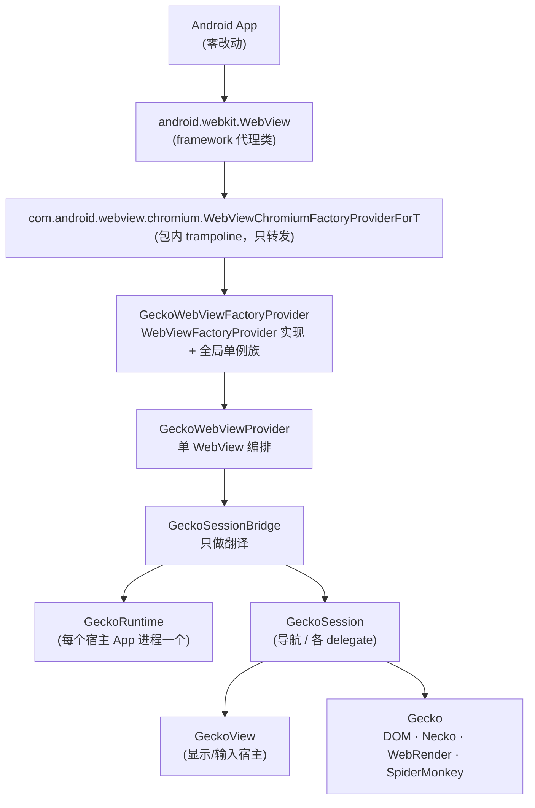
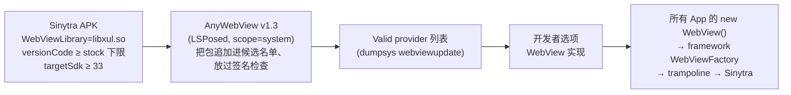
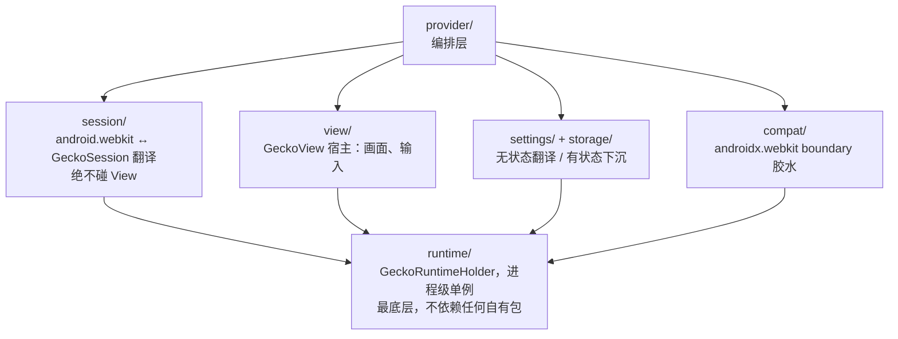

# Sinytra — Gecko 内核的 Android System WebView

*English version: [README.md](README.md).*

Sinytra 是一个第三方 Android System WebView 实现：App 层**完全不改**
`android.webkit.WebView` 调用代码，底层引擎从 Chromium 换成
Firefox/Gecko。



> 个人实验性质项目，与 Mozilla / Google 无关。
> 进展、verdict 与诊断记录见 [`docs/STATUS.md`](docs/STATUS.md) 与
> [`docs/VERDICTS.md`](docs/VERDICTS.md)；新会话先读它们。

## 版本 pin（source of truth）

| 项 | 值 |
|---|---|
| `TARGET_ANDROID_API` | 34（Android 14，对齐调试机） |
| `AOSP_BASE` | `android14-release`——只做接口语义/类名/加载流程的参考源；不编译，运行期事实以设备 framework 为准 |
| `GECKOVIEW_VERSION` | `geckoview-nightly:158.0.20260924093433` |
| `FIREFOX_COMMIT` | `34ed69f161676c3ac7ca5f201fade6d081e5bcd2`（mozilla-central 158.0a1 最后一刻；158.0 正式 tag 出来后再评估切换） |

Android 14 的 `WebViewFactory` 把 Chromium factory 类名**硬编码**了，
不读 provider 声明的任何 factory 类名——所以上面那个 trampoline 是不
改 framework 前提下的**唯一入口**。

## 部署路线（唯一支持的路线）

已 root + LSPosed + AnyWebView v1.3 的手机，经「开发者选项 → WebView
实现」切换（等价 `cmd webviewupdate set-webview-implementation`）。
不刷机、不改 framework、不做 overlay、不需要系统签名。



validity 硬约束（全部真机实测）：manifest 带
`com.android.webview.WebViewLibrary = libxul.so`（**真实**的 .so——
framework 对它的 RELRO 预加载失败属预期且无害，Gecko 自己经
`GeckoLoader` 加载）；`versionCode ≥ Minimum WebView version code`；
自有包名（`moe.bemly.geckowebview`，debug 为 `.debug` 后缀——绝不顶
`com.android.webview`）。

## 架构设计

### 分层与依赖方向（单向，违反即打回）



硬规则（只列最重要的）：

- `GeckoRuntime`：**每个宿主 App 进程最多一个活动实例**（provider
  代码是被加载进每个用 WebView 的宿主进程的——不是全系统共享，也
  不是跨进程共享）。
- `GeckoView` **不是** `GeckoRuntime` 的下一层：它是单个 session 的
  显示/输入宿主（`session.open(runtime)` + `view.setSession(session)`）。
  无 View 的后台 session 靠 `setActive/setPriorityHint` 手动管理。
- **历史归 Gecko 管**（`SessionState` 本身即 `HistoryList`）。
  `StateBridge` 只做 `SessionState/HistoryList ↔ WebBackForwardList/
  Bundle` 转译——不许自建历史栈；`HistoryDelegate` 只做 visited 记录 +
  变更通知。
- **复用优先**：GeckoView / `androidx.webkit` / framework 已有的能力一
  律直接复用，不包同名类、不另起状态机。允许自研的只有：GeckoView
  明确不存数据的（visited 落盘、表单/密码库、图标缓存）、Chromium
  语义 Gecko 无对应的（JS interface 反射、WebMessage 通道、`Bundle`
  转译）、不改 framework 的接入适配（trampoline、framework 同包子类），
  以及下面的 `sinytra-js`。
- 胶水主体一律 **Java 17**。C++ / Gecko JS 只在 public API 确实缺
  primitive 时下沉，每个下沉项走 `firefox-patches/` 独立 patch + 独立
  测试；Rust 基本不碰。

### JS 通道：内置 `sinytra-js` 扩展

`evaluateJavascript` / `addJavascriptInterface` / WebMessage **不需要**
Gecko patch：内置 WebExtension（`provider/src/main/assets/sinytra-js`，
id `sinytra-js@bemly.moe`）打通页面与 Java。content script 轮询
session 级 native mailbox（`GeckoResult` 长轮询语义），注入的页面侧
shim 执行 eval、安装 `window[iface]` stub（Java 反射兜底）、收发端口
消息。协议全文见 `content.js` 头注释；7 轮真机排除 Port push 的记录
见 `JsBridge.java` 头注释。

### 请求拦截：`firefox-patches/` 0001–0003

`shouldInterceptRequest` 返回 body 的能力走 necko 层
`nsINetworkInterceptController`：filter 下发（0001）、method/headers
保真 + 子帧让位（0002）、JNI 上无上限流式 body（0003——16MB base64
上限解的是不存在的问题：边界是 JNI 不是进程）。

### Gecko patch 栈（HEAD：0024）

每个 patch 只做一件事、独立测试。完整说明见
[`firefox-patches/README.md`](firefox-patches/README.md)。

| # | 内容 | 服务的 WebView API |
|---|---|---|
| 0001–0003 | 响应体拦截线 | `shouldInterceptRequest` body / 请求面保真 / 流式 |
| 0004 | 合成响应 SW tainting（ORB 加固） | 顶层导航合成响应 |
| 0005 | `SINYTRA_LOG` 宏 + `sinytra.log.enabled` pref 门 | debug 插桩纪律 |
| 0006 | 证书例外链（失败 channel 证书 → stash → temporary override） | `SslErrorHandler.proceed()` |
| 0007/0011/0014/0016/0019 | cookie-jar 原语 + 读写域收敛 | `CookieManager` 逐 cookie 语义 |
| 0008–0010 | greomni 指向 provider APK、child service 跨包、网络状态守卫 | 第三方宿主进程里 Gecko 能起来 |
| 0012/0015 | 资源面 + 合成追踪 | 策略判定、triage |
| 0013 | `resource://android` 指向 provider APK | 第三方宿主下的 JS transport |
| 0017/0021–0023 | Binder 有界失败 + surface handoff 排序 | compositor teardown/startup 恢复（GPU-ON 主线修复；M3/M3b 为已登记 fallback） |
| 0018 | UA override 推送到顶 context | `WebSettings` UA 落线 |
| 0020 | `file:///android_asset/` 映射到宿主 APK | file 族 CTS |
| 0024 | 图片策略 docshell 落实 | `setLoadsImagesAutomatically` |

可重现 = `FIREFOX_COMMIT` + `firefox-patches/*.patch` 按编号打到
sibling checkout 上（永远不做 submodule、不拼不完整 fork）。

## 仓库结构（本 Git 只存差异）

```text
sinytra/
├── docs/                  # ARCHITECTURE / API_MAPPING / BOOTSTRAP / ROADMAP /
│                          #   STATUS / DEVICE / CTS / SOURCES / VERDICTS
├── provider/              # 独立 Java 17 Gradle 工程（日常开发几乎只碰这里）
│   └── src/
│       ├── main/java/org/mozilla/geckowebview/
│       │   └── provider/ session/ view/ settings/ storage/ compat/ runtime/
│       ├── main/java/com/android/webview/chromium/  # 入口 trampoline
│       ├── main/java/android/webkit/                # 同包子类
│       ├── main/java/org/chromium/support_lib_glue/ # androidx boundary 入口
│       ├── main/assets/sinytra-js/                  # 内置 transport
│       └── debug/         # 设备 harness + 探针（含 LabActivity）——release 零引用
├── framework-stubs/       # compileOnly 的 android14 hidden API stubs
├── firefox-patches/       # patch 栈 + 逐 patch 设计文档
└── tests/unit/            # JVM 单测（每 bridge 至少一单测）
```

阶段门槛（顺序不许跳）：P-1 bootstrap spike → P0（约 20% API 跑起来）
→ P1（系统能力）→ P2（硬骨头 + 切换后 CTS）。最终验收一律在切换后
的真实路径上（`new WebView()` 经 framework `WebViewFactory` 进入
Sinytra）；反射注入 harness 只是回归手段。范围与验收见
[`docs/ROADMAP.md`](docs/ROADMAP.md)。

## 构建与安装

前置：JDK 17、Android SDK（platforms 34/36/37.x）、sibling Firefox
checkout（分支 `sinytra-pin-158` + `objdir-158` 已构建）、rustup 的
Rust。master 的一切构建/测试**必须**带 `-PsinytraLocalGecko=true`
（master 引用 patch 注入的 GeckoView 类型，stock AAR 默认构建红是
预期状态）。

```bash
export JAVA_HOME=<jdk17> ANDROID_HOME=<sdk> \
  MOZCONFIG=<firefox>/mozconfig-158 \
  MOZBUILD_STATE_PATH=<mozbuild> PATH="$HOME/.cargo/bin:$PATH"

./gradlew :provider:testDebugUnitTest -PsinytraLocalGecko=true  # JVM 单测锁
./gradlew :provider:lintDebug -PsinytraLocalGecko=true          # lint 门
./gradlew :provider:assembleDebug -PsinytraLocalGecko=true     # debug APK

adb -s <serial> install -r provider/build/outputs/apk/debug/provider-debug.apk
adb -s <serial> shell "su -c 'dumpsys webviewupdate'" | grep -A12 'WebView packages'
adb -s <serial> shell cmd webviewupdate set-webview-implementation moe.bemly.geckowebview.debug
```

新包名首次安装后，候选名单在 `system_server` 启动时重建——装完
**重启一次**再切换。回滚随时：
`cmd webviewupdate set-webview-implementation com.google.android.webview`。

debug 包额外带 **Sinytra Lab**（桌面图标）：scheme 感知的地址栏、
User-Agent 改写（`navigator.userAgent` 回读验证）、一键
`about:about/config/support/buildconfig`。release 包里一个都没有。

## 测试

- `tests/unit`——JUnit，覆盖每 bridge 的映射逻辑与边界值。
- `provider/src/debug`——设备 harness（反射注入做 bridge 级回归）+
  切换后真实路径探针（最终验收）。
- CTS——切换后在设备上 `am instrument` 直跑 `CtsWebkitTestCases`
  （android-cts-14_r7 arm 包）；Chromium 基线 98.6% 为分母，每条 fail
  逐条归因（Gecko 语义差异 / 未实现 / 上游 bug）。逐用例台账见
  [`docs/VERDICTS.md`](docs/VERDICTS.md)。

## 文档索引

| 文件 | 内容 |
|---|---|
| [`docs/ARCHITECTURE.md`](docs/ARCHITECTURE.md) | 技术选型、三核心类、结构图、分层依赖、历史语义、运行时事实、语言策略 |
| [`docs/API_MAPPING.md`](docs/API_MAPPING.md) | GeckoView delegate / controller / settings 对照表（写 bridge 前先查） |
| [`docs/BOOTSTRAP.md`](docs/BOOTSTRAP.md) | P-1 验收、AnyWebView 切换路线、三层依赖模型、workspace 布局 |
| [`docs/ROADMAP.md`](docs/ROADMAP.md) | P-1 → P0 → P1 → P2、P2 硬点清单、测试验收 |
| [`docs/STATUS.md`](docs/STATUS.md) | 实现进展、下一步、已知阻塞——新会话先读我 |
| [`docs/DEVICE.md`](docs/DEVICE.md) | 调试机档案、adb 与切换流程、卫生/reboot 纪律 |
| [`docs/CTS.md`](docs/CTS.md) | CTS 跑法 + Chromium 基线 |
| [`docs/SOURCES.md`](docs/SOURCES.md) | 上游引用（AOSP 一律 android14-release） |
| [`docs/VERDICTS.md`](docs/VERDICTS.md) | CTS 串行 verdict 台账 |

## 商标声明

Firefox、Gecko 与 Nightly 狐狸 artwork 是 Mozilla 的商标（狐狸图标
只出现在 debug 构建中：Lab 图标 + 应用图标）。Chromium、Android、
WebView 是 Google 的商标。本项目是独立实验性质；商标归各自所有者。
